# Waterski Ramp Controller – User Guide

Last updated 2026-11-25

## Overview

The system sets the ski ramp to one of four heights (4.0, 4.5, 5.0 or 5.5 ft) and switches the ramp's water spray on and off. It has two kinds of unit:

- **Ramp controller**: mounted at the ramp. It drives the lift motor, runs the water pump and reads four magnetic height sensors. It makes every decision.
- **Remotes** (up to 4): one in the boat, one on shore, and so on. A remote only sends requests over the radio and shows what the ramp reports.

Both units use the same board, the same buttons and the same menu pages, so if you can use one you can use the other.

| Control | What it does |
| --- | --- |
| MENU button | Hold 0.5 s to go to the next page |
| BACK / WATER button | Water on/off (WATER page) and a few setup holds |
| UP and DOWN buttons | Drive the ramp by hand (MANUAL page); scroll lists; held together for 2 s they open special functions |
| Height buttons (4.0 / 4.5 / 5.0 / 5.5) | Pick a height (SET HEIGHT page only) |
| LEDs (ramp controller) | Show the height the ramp is at: blue 4.0 ft, green 4.5 ft, yellow 5.0 ft, red 5.5 ft |

The motor is slow on purpose: one 0.5 ft step takes about 70 seconds, and 4.0 to 5.5 ft takes about 3.5 minutes. While the ramp moves, the water pauses and comes back on about 1 second after it stops.

## Using the menus

Hold **MENU for half a second** to move to the next page. A quick tap does nothing, so a bumped button can't change pages. The page number shows top right (for example 2/6).

1. HOME: status only
2. WATER: water on/off
3. SET HEIGHT: pick a height
4. MANUAL: drive the ramp up or down by hand
5. DIAGNOSTICS: faults and sensor readings
6. NETWORK: radio link details

After NETWORK it goes back to HOME.

- **Screen sleep:** the screen turns off after 1 minute without a button press and returns to HOME. It stays on while the ramp is moving, so you can watch a move finish. The first press only wakes it; it never does anything else.
- **HOME does nothing on purpose.** Press a height button there and the bottom line says "Set height: page 3"; press BACK and it says "Water: page 2".
- **UP + DOWN held together for 2 seconds** is the special-function hold. What it does depends on the page: open the games (HOME), switch the remote's water mode (remote WATER page), change the remote's ID (remote NETWORK page) and turn on the testing bypass (ramp MANUAL page only). Pressing two buttons for 2 seconds can't happen by accident.

## Ramp controller, page by page

Everything on the ramp controller can be done from its own buttons, and it always has priority over the remotes.

The screenshots are drawn from the firmware's own screen commands; on the real display the font is a little more pixelated.

### 1. HOME

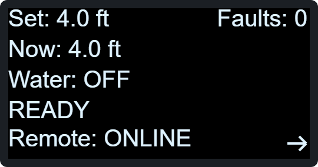

HOME shows the status and nothing else: the target height (Set), the height the ramp is at (Now), the water timer, the status line and whether any remote is online. Fault count is top right. A height is blank when it isn't known yet (see Calibration).

Status line: READY, MOVING UP / MOVING DOWN, CAL REQUIRED, SENSOR FAULT, MOTOR TIMEOUT or BYPASS ON!.

### 2. WATER

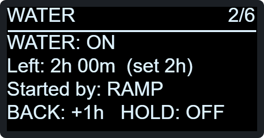

- **Tap BACK:** adds 1 hour to the water timer (1 to 12 hours). The tap after 12 hours turns the water off.
- **Hold BACK 1 second:** water off now.

The page shows time left, the hours set and who started it: RAMP, REMOTE (a boat remote) or "Timer by: REMOTE n" (a shore remote).

### 3. SET HEIGHT

Press a height button (4.0, 4.5, 5.0 or 5.5 ft) and the ramp drives there and stops on that height's sensor. The bottom line shows Ready, Moving UP / DOWN, At height or why it can't move.

Height buttons only work on this page, so a button bumped on another page can't move the ramp. While a height picked at the ramp is moving, the remotes can't change it.

### 4. MANUAL ADJUST

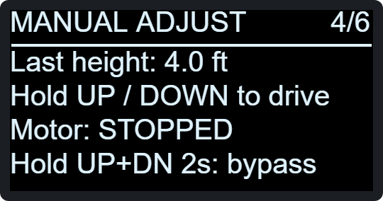

Hold **UP** or **DOWN** to drive the ramp; let go and it stops at once.

- The press has to start on this page. Holding a button while you arrive does nothing.
- Pressing both buttons stops the motor.
- It stops by itself at the top (5.5 ft) and bottom (4.0 ft) sensors.
- Changing direction waits 1 second so the motor can stop turning first.
- The bottom line is the testing bypass (see Setup and maintenance).

### 5. DIAGNOSTICS

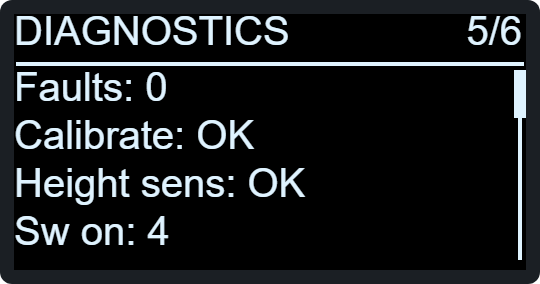

A scrolling list (UP / DOWN) of faults and readings: calibration, sensor faults, which sensors read on, motor timeout, the last sensor zone and step times, overcurrent, bypass, motor and mode, heights, remotes online, the height-button reading and uptime.

At the bottom of the list is **Motor usage**: how much the ramp has been used since it was first flashed.

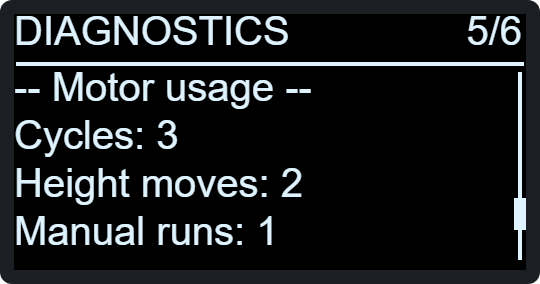

- **Cycles**: every time the motor has run, from start to stop. A height move is usually one cycle, each press-and-hold on the MANUAL page is one, and a move that changes direction part way is two. Split into height moves and manual runs, and into up and down.
- **Run time**: total time the motor has been on.
- **Travelled**: total height the ramp has moved, in feet (counted each time it reaches a different height sensor).
- **Avg step**: average time for one 0.5 ft step between sensors. Compare it with "Step" higher up the list: a step that takes noticeably longer than the average can mean the jack or motor is wearing or binding.

The counters are saved, so they survive power cuts and firmware updates. Only erasing the board's whole flash would reset them (the web flasher never does that). The remotes don't show them.

### 6. NETWORK

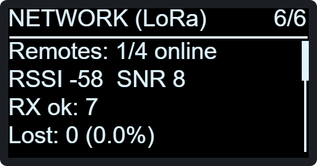

A scrolling list of radio statistics: how many remotes are online, the bind code ("Bind: 3F2A", see Setup below), signal strength, packets received and lost, packets refused, and one line per remote (R1 to R4) with its signal and when it was last heard.

## Remote, page by page

The remote has the same six pages. It sends each request to the ramp and shows what the ramp reports back. If the remote loses the radio link, the heights go blank and the screens say NO RAMP LINK.

### 1. HOME

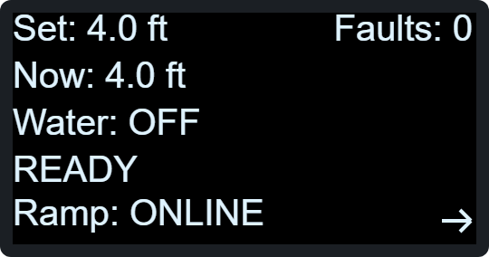

Same as the ramp's HOME, but the bottom line shows "Ramp: ONLINE / OFFLINE". Extra status messages: NO RAMP LINK, RAMP IN USE (someone is using the ramp's own buttons), REMOTE 2 IN CONTROL (another remote is using the ramp, see below) and NO RESPONSE (a request wasn't answered).

**One remote at a time.** When the ramp takes a height pick or manual drive from a remote, that remote has control until the ramp has stopped moving and 5 more seconds have passed. Meanwhile the other remotes can't pick a height or drive it by hand: their screens say "Remote 2 has control" (with that remote's number). Water still works from every remote, and the buttons on the ramp itself always win.

### 2. WATER

The title shows the remote's **water mode**, a setting saved on each remote. To switch it, hold **UP + DOWN for 2 seconds** on this page.

| | WATER (BOAT) | WATER (TIMER) |
| --- | --- | --- |
| Meant for | A remote that stays switched on while in use (in the boat) | A remote that sleeps between presses (solar, on shore) |
| Tap BACK | Water on / off | +1 hour (1 to 12 h); the tap after 12 h turns it off |
| Hold BACK 1 s | Same as a tap | Water off now |
| How long it runs | Only while this remote is on and in range; stops within 1 hour after that | The hours set, even if the remote is off |

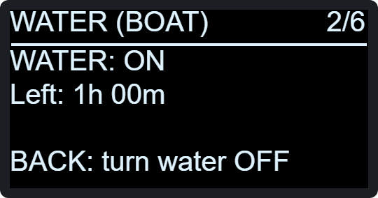

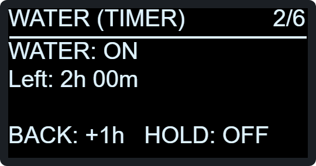

Quick taps in TIMER mode are queued ("Adding +3 h...") and each counts exactly once.

### 3. SET HEIGHT

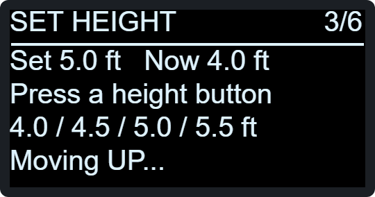

Works like the ramp: press a height button. The bottom line shows Sending..., then the ramp's progress, or why it was refused: "Ramp buttons in use", "Remote 2 has control", "No response, retry", "Ramp CAL REQUIRED".

### 4. MANUAL ADJUST

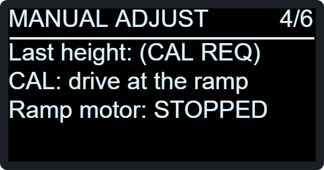

Hold **UP** or **DOWN** to drive the ramp from the remote. If the radio drops out, the ramp stops within 1 second. The ramp refuses remote driving, and the second line says why, when:

- it needs calibration: "CAL: drive at the ramp"
- the testing bypass is on: "BYPASS: ramp btns only"
- someone is holding a button at the ramp: "Ramp buttons in use!"
- another remote has control: "Remote 2 has control"
- the ramp is set to allow manual driving only at the ramp: "Manual: at the ramp only"

### 5. DIAGNOSTICS

The ramp's fault list, as the ramp reports it, plus whether remote manual driving is allowed.

### 6. NETWORK

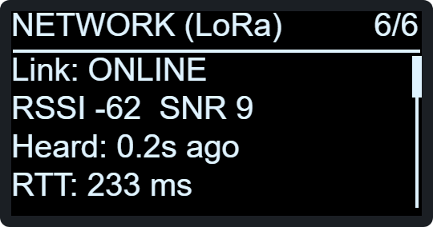

This remote's link: online or not, signal strength, when the ramp was last heard, round-trip time and packet counts. It also shows this remote's **ID** (1 to 4) and **water mode**. To change the ID, hold **UP + DOWN for 2 seconds** on this page.

## Calibration and faults

The ramp only knows its height while it sits on one of the four sensors. When it can't trust its height, it shows **CAL REQUIRED** and waits for someone at the ramp.

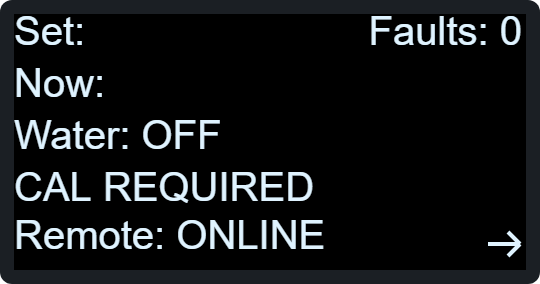

| Message | Why | What to do |
| --- | --- | --- |
| CAL REQUIRED | No sensor was on at power-up (it may have been moved while off), the power was cut while it was moving, or it was just reflashed | At the ramp: MANUAL page, hold UP or DOWN until it reaches any height. The first sensor it reaches clears it. Heights picked from the ramp or a remote, and driving from a remote, are refused until then. |
| SENSOR FAULT | Two sensors read on at once (a wiring fault or an unplugged sensor), or a move went past its target's sensor without seeing it | Check the sensor wiring; DIAGNOSTICS lists which sensors read on and which are faulty. The motor won't run until the ramp controller is switched off and on again. |
| MOTOR TIMEOUT | The motor ran 100 seconds without reaching the next sensor (jammed, slipping or a dead sensor) | Find out why it didn't arrive, then switch the ramp controller off and on again to clear it. |
| NO RAMP LINK (remote) | The remote can't hear the ramp: out of range or the ramp is off | Move closer or check the ramp controller has power. |

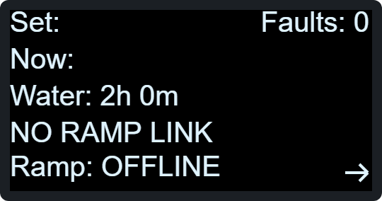

After switching the ramp off and on, it may show CAL REQUIRED if it isn't sitting on a sensor. Drive it to a height from the MANUAL page as above.

## Games

Both units have a hidden Water Ski Arcade with five games. The games never touch the motor, the water or the radio, and the ramp's safety checks keep running while you play.

- **Open:** on HOME (page 1 only), hold **UP + DOWN together for 2 seconds**.
- **Pick a game:** UP / DOWN, then tap MENU to play. Tap BACK to return to the game list.
- **Leave:** hold MENU for half a second. You go back to HOME.

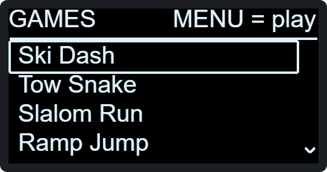

| Game | Controls |
| --- | --- |
| Ski Dash: jump the buoys | UP jump, hold DOWN to fall faster |
| Tow Snake: the boat and rope grab slalom flags | UP turn left, DOWN turn right |
| Slalom Run: steer through the gates | Hold UP / DOWN to steer |
| Ramp Jump: pick a height, stop the power meter in the sweet spot | UP / DOWN pick, MENU go, UP or MENU stop |
| Trick Combo: repeat the trick sequence | UP jump, MENU spin, DOWN duck |

Best scores reset when the unit is switched off.

## Quick reference

Hold MENU 0.5 s on any page to go to the next one.

| Page | Ramp controller | Remote |
| --- | --- | --- |
| 1 HOME | Status only. UP + DOWN 2 s: games | Status only. UP + DOWN 2 s: games |
| 2 WATER | Tap BACK +1 h (1 to 12 h); hold BACK 1 s off | BOAT: tap BACK on/off. TIMER: tap BACK +1 h, hold BACK 1 s off. UP + DOWN 2 s: switch BOAT / TIMER |
| 3 SET HEIGHT | Height buttons pick 4.0 / 4.5 / 5.0 / 5.5 ft | Same (sent to the ramp) |
| 4 MANUAL | Hold UP / DOWN to drive. UP + DOWN 2 s: testing bypass on/off | Hold UP / DOWN to drive (refused during CAL REQUIRED or bypass) |
| 5 DIAGNOSTICS | UP / DOWN scroll | UP / DOWN scroll |
| 6 NETWORK | UP / DOWN scroll | UP / DOWN scroll. UP + DOWN 2 s: change remote ID |
| Games | UP / DOWN pick, tap MENU play, tap BACK list, hold MENU leave | Same |

## Setup and maintenance

**Bind phrase (radio security).** The radio messages are encrypted with a bind phrase, so only boards flashed with the same phrase can control the ramp. The web flasher asks for it before flashing: use the **same phrase for the ramp and every remote**, keep it private, and write it down (you need it to add or replace a remote). There's no pairing step. After flashing, check that every board's NETWORK page shows the same `Bind:` code; the flasher shows the code for the phrase you typed. On the NETWORK page:
- "Bind: NONE (open)" means the board has no phrase: it only talks to other boards without one, and anyone could control it. Reflash it with the phrase.
- "Bad key" counts packets from a board with a different phrase.
- "Old firmware heard" means a board still runs older, unencrypted firmware. Reflash it: old and new firmware can't talk to each other.

**Each remote needs its own ID (1 to 4)** and a type: Boat (BOAT water mode, for the boat remote) or Shore (TIMER water mode, for a sleeping shore remote). Pick both in the web flasher before flashing a remote; it takes them on its first start after flashing. To change them later on the remote: NETWORK page, hold UP + DOWN for 2 seconds to step the ID 1 → 2 → 3 → 4 → 1; WATER page, hold UP + DOWN for 2 seconds to switch BOAT / TIMER. Pick an ID no other remote uses; the ramp's NETWORK page lists R1 to R4. Both are saved and kept when the remote is updated from the Arduino IDE; a web flash sets them to what you picked in the flasher.

**Testing bypass (bench testing only).** On the ramp's MANUAL page, hold UP + DOWN for 2 seconds. While it's on, manual driving ignores the end sensors and sensor faults, so watch the ramp. Height picks and all remote driving are refused, the motor timeout still applies, and it switches off at every restart. It can't be turned on from a remote.

**Reflashing.** Use the browser flasher at [lkagrifter.github.io/waterski-ramp](https://lkagrifter.github.io/waterski-ramp/) in Chrome or Edge. Flash the ramp and all remotes from the same version, with the same bind phrase. Saved settings are kept: the flasher never erases the board, because erasing would also delete the board's Heltec radio license.

**Stuck on "Starting radio..." after flashing** (or, with older firmware, the screen stays off). Check the board's messages (Arduino IDE > Tools > Serial Monitor, 115200 baud). If it repeats "Please provide a correct license!" with an `ESP32ChipID=`, the board's Heltec license has been erased (by a full flash erase in some tool). Look up the chip ID at [resource.heltec.cn/search](https://resource.heltec.cn/search) to get four numbers like `0xC2F3D087,0x...`, then send `AT+CDKEY=` followed by them without the `0x` and commas (32 characters) in the Serial Monitor, with line ending "Both NL & CR". It answers "The board is actived" and starts, and keeps the license from then on.

**Firmware settings** (top of each sketch; change, then reflash):

| Setting | Unit | Normal value | What it does |
| --- | --- | --- | --- |
| `ALLOW_REMOTE_MANUAL` | Ramp | true | false = manual driving only at the ramp |
| `ONE_REMOTE_AT_A_TIME` | Ramp | true | false = any remote can pick a height at any time (the last pick wins) |
| `REMOTE_CONTROL_HOLD_MS` | Ramp | 5000 | how long a remote keeps control after the ramp stops (ms) |
| `ALLOW_HEIGHT_SAFETY_BYPASS` | Ramp | true | false = no testing bypass at all |
| `ALLOW_BYPASS_FROM_REMOTE` | Ramp | false | true = remotes may switch the bypass |
| `HEIGHT_SAFETY_BYPASS_AT_BOOT` | Ramp | false | true = starts with the bypass on (bench without sensors) |
| `SIM_MODE` | Ramp | false | true = simulator board: relays never switch. Never on the real ramp |
| `LADDER_CALIBRATION_MODE` | Both | false | true = shows the raw height-button reading for re-calibration |
